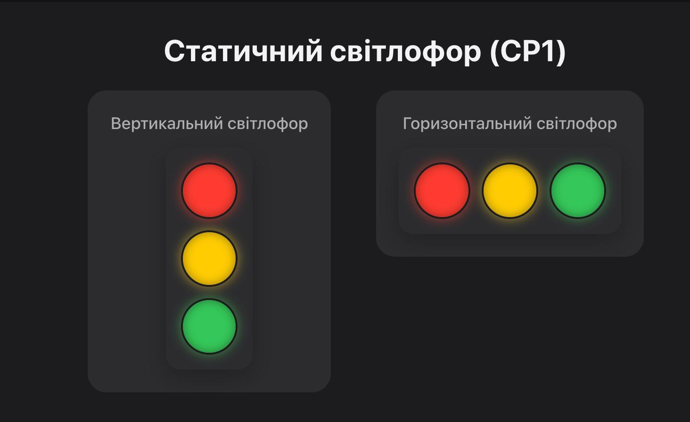

# Лабораторна робота №1. Компонентна модель «Світлофора» (CP1)

Статичний React/Vite-застосунок «Світлофор», що демонструє побудову інтерфейсу з повторно використовуваних компонентів та передачу даних через `props`.

## Скріншот роботи

## Структура компонентів
- **`Light`** — окремий сигнал (лампа) світлофора, колір отримує через `props`.
- **`TrafficLights`** — компонує 3 сигнали (`red`, `yellow`, `green`) та приймає орієнтацію (`vertical` / `horizontal`).
- **`App`** — демонструє обидва варіанти світлофора одночасно.